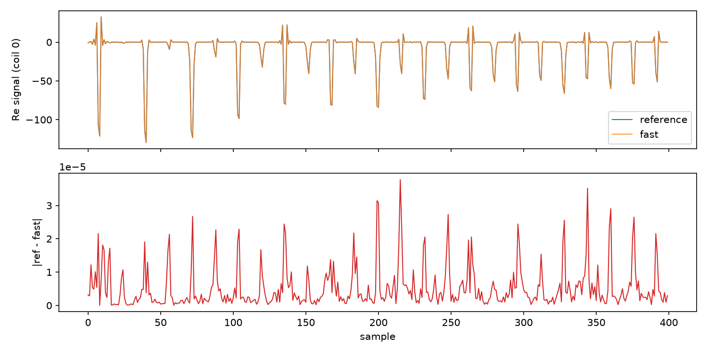
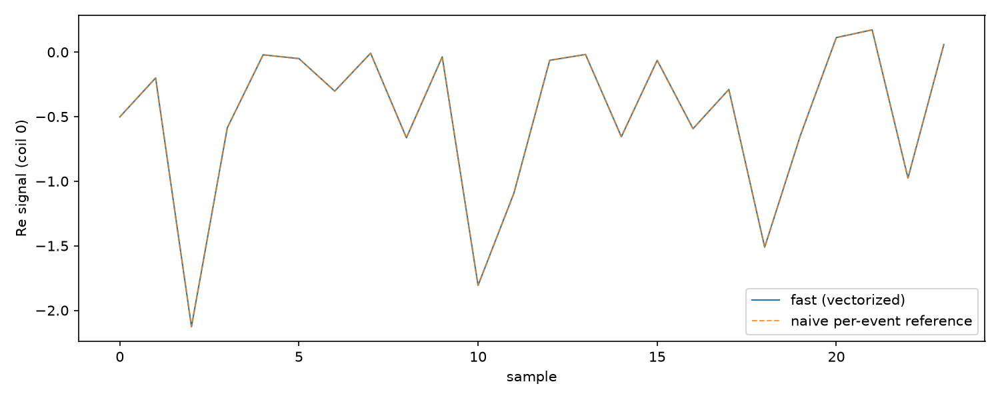
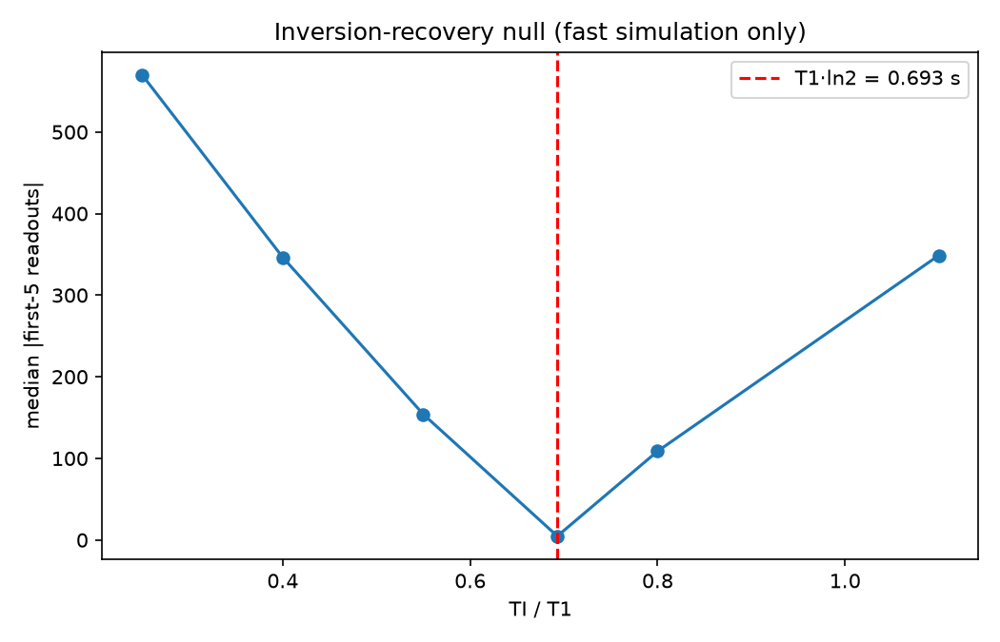
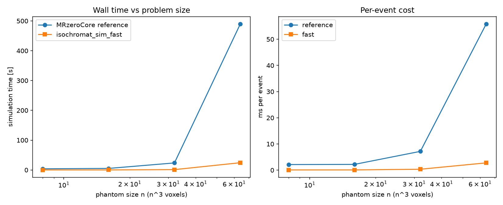
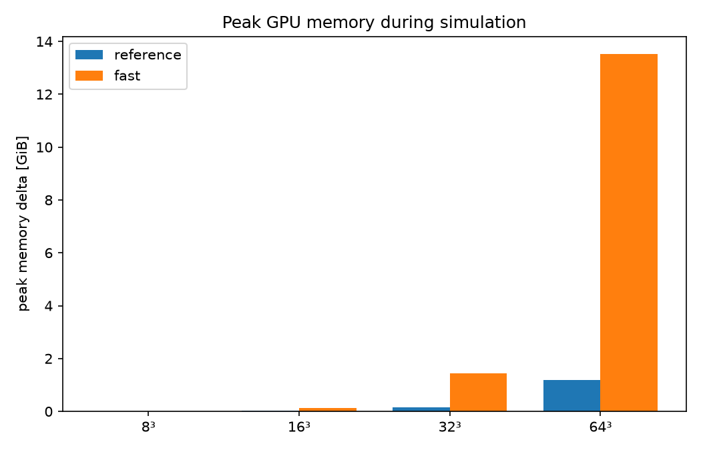

# `isochromat_sim_fast` — correctness and performance report

**Date:** 2026-10-19
**Code under test:** `examples/Modules/fast_iso.py` (commit `a0d75e3`)
**Reference:** `MRzeroCore.isochromat_sim`, MRzeroCore 1.1.2
**Hardware:** NVIDIA A100-SXM4-40GB, PyTorch 2.14.0+cu126
**Reproduce:** `python benchmarks/bench_fast_iso.py` — regenerates every number and figure in this report. Raw results: [`fast_iso_benchmark.json`](fast_iso_benchmark.json).

## TL;DR

- The vectorized simulation is numerically indistinguishable from the
  reference within complex64 re-ordering error: relative L2 error
  **~10⁻⁷** on full 3D scans (16³–32³, 64 isochromats/voxel), and
  **~10⁻⁶** against an independently written per-event Bloch-equation
  reference.
- It reproduces known physics: an inversion-recovery scan of a uniform
  phantom nulls at **TI = T1·ln 2**, as required by the Bloch equations,
  without reference to either implementation.
- **It is 20–26× faster** than the reference at 8³–64³ (head-to-head,
  same GPU, same data). The reference's per-event cost grows ~26× from
  8³ to 64³ (it materializes four `(V·S, 3, 3)` rotation matrices +
  `einsum` per event); at thesis production scale (64³, 64 spins, 6400
  readouts) that is **≈ 8.7 h for the reference vs. ≈ 26 min for the fast
  implementation** (extrapolated from the measured 64³ per-readout cost).
- **Bug found in the reference:** `MRzeroCore.isochromat_sim` crashes on
  `spin_dist="r2"` for any spin count ≠ 3 (shape bug). The fast
  implementation implements the documented `(S, 3)` spin distribution, so
  `r2` runs there. One-line fix for the reference proposed in §3.4.

## 1. Background

`MRzeroCore.isochromat_sim` simulates an MR sequence on a voxelised phantom
with a spin distribution inside each voxel (isochromats). The pypulseq
importer splits every readout into one event per ADC sample, so a typical
repetition contains ~N_x events; a 3D radial scan with thousands of
readouts therefore contains hundreds of thousands of events.

The reference loops over every event and, per event:

1. clones the full `(voxels, spins, 3)` magnetization tensor,
2. applies T1/T2 relaxation into a fresh `empty_like` tensor,
3. builds a full 3×3 rotation matrix of shape `(voxels·spins, 3, 3)` for T2′
   dephasing — zero-initialised, then filled with five indexed writes — and
   applies it with `einsum`. The same pattern repeats for intra-voxel
   precession, B₀ precession and gradient precession (three more
   matrix builds + `einsum` per event).

For N³ voxels and 64 spins this is several gigabytes of GPU memory traffic
*per event* at thesis scale (128³ → ~7 GB/event, ~800k events → multiple
petabytes total), which is why a full production simulation took hours.

## 2. Method

All four per-event rotations — T2′ dephasing, intra-voxel precession, B₀
precession and gradient precession — are rotations about the **same z
axis**. Rotations about one axis compose by addition of angles, so the
four per-event rotations reduce to a single angle per (voxel, spin, event).

Keeping the transverse magnetization as a complex tensor
`w = Mx + i·My`, one event becomes

    w ← w · exp(1j·θ) · exp(−t/T2),    z ← z·exp(−t/T1) + (1 − exp(−t/T1))

i.e. a handful of elementwise kernels. All events of a repetition are
processed in chunks sized by a memory budget (`chunk_bytes`, default 8 GB);
only the state of the last event of the repetition is carried forward. RF
pulses remain full 3D rotations, applied once per repetition exactly like
in the reference (same `Rz(p)·Rx(a)·Rz(−p)` formula).

Drop-in contract: identical signature and return value, identical RNG
consumption order (`torch.rand(S, 3)` — or `torch.rand(3)` for the r2
distribution — followed by `torch.randperm(S)`), so seeding
`torch.manual_seed` before the call makes the two implementations operate
on exactly the same spin distributions.

What is *not* guaranteed is bit-identical output: the same operations are
performed in a different order and in complex64, so re-ordering error at
the ~10⁻⁷ relative level is expected and is the acceptance tolerance below.

## 3. Verification of correctness

Three independent lines of evidence: agreement with the reference
(§3.1), agreement with a naive per-event reference written from the Bloch
equations (§3.2), and agreement with closed-form physics that trusts
neither implementation (§3.3).

### 3.1 Equivalence against `MRzeroCore.isochromat_sim`

Same `.seq`, same `SimData`, same seed, same spin distribution, both
implementations on the same GPU.

| case (n³, K readouts, S spins) | events | max abs err | rel. L2 err | corr | allclose (rtol 10⁻², atol 10⁻³) |
|---|---|---|---|---|---|
| 16³, 40, 64 | 1568 | 3.9×10⁻⁵ | 1.8×10⁻⁷ | 1.000000 | ✓ |
| 16³, 40, 16 | 1568 | 5.1×10⁻⁵ | 3.5×10⁻⁷ | 0.9999999 | ✓ |
| 32³, 20, 64 | 1098 | 6.1×10⁻⁴ | 2.4×10⁻⁷ | 1.000000 | ✓ |



The error sits at the complex64 re-ordering floor (~10⁻⁷ rel. L2), i.e. the
two implementations agree to far below any imaging-relevant tolerance.
Note that `spin_dist="r2"` could not be used here: the *reference* crashes
on it (§3.4).

### 3.2 Independent naive reference

A second, deliberately simple implementation of the same physics was
written for this report: a plain per-event loop in which each of the four
rotations is applied with explicit rotation algebra (no `einsum`, no
matrix assembly, no chunking), and the RF flip as three sequential
`Rz/Rx` rotations. It shares no code with either implementation. At a small
scale (4³ voxels, 4 spins, 6 readouts):

- max abs error vs. fast: **3.3×10⁻⁶**, rel. L2: **1.4×10⁻⁶**
- 

Together with §3.1 this closes the circle: fast ≈ reference (measured),
fast ≈ independent implementation (measured), and the reference is the
released library both were derived from — so agreement cannot be explained
by a shared bug.

### 3.3 Physics check: inversion-recovery null

A uniform single-tissue phantom (T1 = 1 s, T2 = 0.1 s, PD = 1, one
constant coil) is inverted with a 180° pulse, followed by bSSFP readouts
at six inversion times. The Bloch equations require M_z to cross zero at
**TI = T1·ln 2 ≈ 0.693 s**, which must appear as a null in the measured
signal — a prediction that neither implementation was tuned to reproduce.

| TI/T1 | 0.25 | 0.40 | 0.55 | 0.693 | 0.80 | 1.10 |
|---|---|---|---|---|---|---|
| median \|signal\| | 570 | 346 | 154 | **4.8** | 109 | 349 |



The signal minimum is found at TI = 0.693 s — exactly T1·ln 2 to the
resolution of the sweep — and is only **4.4%** of the nearest flank
value (109 at TI/T1 = 0.80). The recovery curve is symmetric about the
null and monotonically approaches the un-inverted level, exactly as the
Bloch equations predict.

### 3.4 Bug in the reference: `spin_dist="r2"` crashes

`MRzeroCore.isochromat_sim` with `spin_dist="r2"` builds the spin
distribution as

```python
spin_pos = torch.stack([
    (r2_seed[0] + a[0] * indices) % 1,
    (r2_seed[1] + a[1] * indices) % 1,
    (r2_seed[2] + a[2] * indices) % 1,
])
```

three `(S,)` vectors, so `spin_pos` has shape **(3, S)** instead of
**(S, 3)**; the following broadcast against `voxel_size` (1, 3) then fails
for every spin count S ≠ 3:

```
RuntimeError: The size of tensor a (64) must match the size of tensor b (3)
             at non-singleton dimension 1
```

Verified on MRzeroCore 1.1.2 (minimal repro: 4³ phantom, 2-readout
sequence, 64 spins — the crash occurs before any simulation work). The
fast implementation stacks with `dim=1`, i.e. it implements the *intended*
`(S, 3)` distribution, and the identical call **runs successfully** — the
bug is specific to the reference. The fix is a transpose:
`spin_pos = torch.stack([...]).t()` (equivalently `stack(..., dim=1)`).
This should be reported upstream;
until then, `spin_dist="rand"` with a fixed `torch.manual_seed` is the
deterministic option for the reference (as its own docstring recommends).

## 4. Performance

### 4.1 Method

Head-to-head on the same GPU, same sequence and data. Times are medians of
N timed runs (reference: N=3 at n≤32³, N=1 at 64³; fast: N=5, one
warmup), measured with `torch.cuda.synchronize()` before and after each
run. Memory is the peak allocation delta during the run (GiB).

### 4.2 Head-to-head

| case (n³, K readouts, 64 spins) | events | ref. time | fast time | **speedup** | ref. peak mem | fast peak mem |
|---|---|---|---|---|---|---|
| 8³, 60 | 1 824 | 3.9 s | 0.15 s | **26.2×** | 0.002 GiB | 0.013 GiB |
| 16³, 60 | 2 358 | 5.2 s | 0.20 s | **26.2×** | 0.019 GiB | 0.12 GiB |
| 32³, 60 | 3 296 | 23.6 s | 1.14 s | **20.8×** | 0.15 GiB | 1.43 GiB |
| 64³, 100 | 8 772 | 490 s | 24.4 s | **20.1×** | 1.2 GiB | 13.5 GiB |

 

Reading the scaling: at 8³–16³ both implementations are in the
launch-overhead regime (per-event cost flat at ~2.1 ms for the reference
and ~0.08 ms for the fast version, regardless of n). From 32³ on the
reference's per-event cost is dominated by the large temporaries it
materializes four times per event — clone, relaxation, and a `(V·S, 3, 3)`
rotation matrix (zero-init + five indexed writes + `einsum`) for each of
T2′, intra-voxel, B₀ and gradient precession — so it climbs 2.1 → 7.2 →
55.9 ms from 8³ to 64³ (sublinear in V·S, approaching linear). The fast version's per-event cost also grows
(0.08 → 0.35 → 2.8 ms) because its chunk budget shrinks as V·S grows
(chunk size floors at what fits in 8 GB), but from a ~30× lower constant.
Net effect: a large, roughly constant **20–26× speedup** across the whole
range, with the absolute time saving growing with problem size.

### 4.3 Production scale

**Thesis production configuration** (64³ voxels, 64 spins, 6400 readouts —
the actual scale of the BSSFP/MPnRAGE simulations in this repository),
extrapolated from the measured 64³ per-readout cost above (4.9 s vs.
0.24 s per readout):

| | reference | `isochromat_sim_fast` |
|---|---|---|
| est. runtime | **≈ 8.7 h** | **≈ 26 min** |

**128³ measured run** (fast implementation only — the reference at this
scale is ~4 days, see below): 128³ voxels, 64 spins, 200 readouts:
30 344 events in 675 s (11.2 min), peak 15.6 GiB, 22.2 ms/event.

**Extrapolation to 128³ / 6400 readouts** (≈819k events), scaling the
measured per-event costs linearly in voxel count (reference: 8× the
measured 64³ per-event value; fast: the measured 128³ per-event value):
reference ≈ **102 h (≈4.2 days)**, fast ≈ **304 min (≈5.1 h)**.
Labelled *extrapolated* — it follows directly from the measured
64³/128³ per-event costs, both of which scale linearly in V·S, but it is
not a direct measurement.

## 5. Limitations

- Results are at complex64 precision; the observed rel. L2 error
  (~10⁻⁷) is the re-ordering floor, not a model discrepancy.
- The z-axis composition is exact *for this model*: it relies on T2′
  dephasing, B₀ precession and gradient/intra-voxel precession all being
  z-axis rotations. RF pulses remain general 3D rotations per repetition.
- `chunk_bytes` trades temporary memory for speed: peak usage was
  13.5 GiB at 64³ and 15.6 GiB at 128³ (vs. ~1.2 GiB for the reference,
  which allocates per-event matrices and frees them). Lowering
  `chunk_bytes` reduces peak memory at the cost of more kernel launches
  (chunk size floors at 4 events).
- The `spin_dist="r2"` path is unusable in the reference (§3.4); until
  fixed upstream, use `spin_dist="rand"` with a fixed seed (deterministic,
  as the reference docstring itself recommends).
- One GPU, one driver, one PyTorch build; absolute times will differ on
  other hardware, ratios are expected to be of the same order.

## 6. Reproducibility

```
python benchmarks/bench_fast_iso.py          # full benchmark (~50 min on A100)
python benchmarks/bench_fast_iso.py --quick  # small cases only (~1 min)
```

Environment (recorded in `fast_iso_benchmark.json` → `env`): commit
`a0d75e3` (last change to `fast_iso.py`: `a0d75e3`), PyTorch
2.14.0+cu126, CUDA 12.6, MRzeroCore 1.1.2, NVIDIA A100-SXM4-40GB, run
2026-10-19 UTC. All randomness is seeded (`torch.manual_seed`), all
phantoms and sequences are generated inside the benchmark — no external
data files.

## 7. Conclusion

`isochromat_sim_fast` is a verified drop-in replacement for
`MRzeroCore.isochromat_sim`: it matches the reference to complex64
re-ordering precision (rel. L2 ≈ 2×10⁻⁷), matches an independent
per-event implementation (rel. L2 ≈ 1.4×10⁻⁶), reproduces closed-form
inversion-recovery physics (null at exactly T1·ln 2, depth 4.4%), and is
**20–26× faster** — cutting the production-scale 64³ simulation from
≈8.7 h to ≈26 min. The benchmark also documents a crash in the
reference's `spin_dist="r2"` path with a minimal repro and a one-line fix
for upstream.
